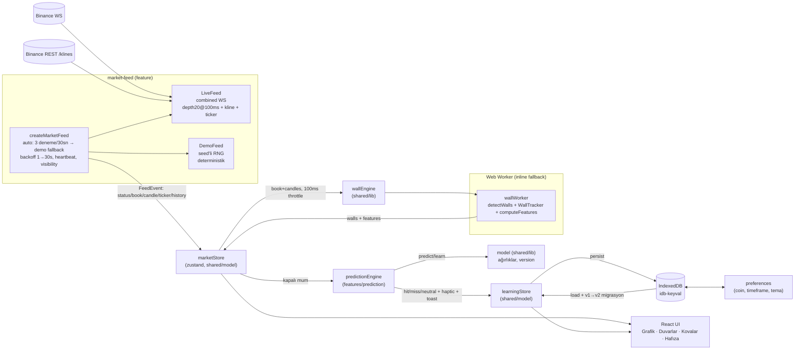

# LANKA v2 — Mimari

## Katmanlar ve Import Kuralları

```
app/        → her şeye erişebilir (orkestrasyon)
features/*  → entities/* + shared/*  (feature ↔ feature YASAK — eslint-plugin-boundaries)
entities/*  → tipler (shared'a erişebilir)
shared/*    → en alt katman (feature/app'a erişemez)
```

Cross-feature runtime state `shared/model` içinde yaşar (zustand store'ları);
saf alan algoritmaları (duvar, feature, model, buckets) `shared/lib` içindedir ki
hem feature'lar hem worker hem worker'ın inline fallback'i aynı kodu kullansın.

## Veri Akışı



## Kritik Akışlar

### 1. Canlı veri döngüsü

1. `app/useFeed` → `createMarketFeed({mode:'auto', symbol, timeframe})`.
2. Live WS birleşik stream'den mesaj → zod doğrulama → `FeedEvent` → `marketStore.apply`.
3. Store 100 ms throttle ile `wallEngine.push({book, candles, config})` çağrır →
   worker `detectWalls` + `WallTracker.tick` + `computeFeatures` → sonucu store'a
   (`walls`, `features`) yazar. Main thread yalnızca render eder.
4. Kline kapanış (`k.x === true`) → `predictionEngine.handleClosedCandle`.

### 2. Tahmin / öğrenme döngüsü

1. Kapalı mum C geldi → önceki `pending` tahmin var mı?
   - `move = (C.close − basePrice) / basePrice`, `threshold = atrMoveFactor · ATR(14)`.
   - `|move| < 0.25·threshold` → neutral; değilse yön eşleşirse hit, yoksa miss.
   - `learn`: `target = sign(move)·min(1, |move|/threshold)`; ağırlıklar güncellenir.
   - istatistik + kova (band) + `recent[]` (≤30) güncellenir → IndexedDB persist.
   - toast + `navigator.vibrate(50)`.
2. Yeni tahmin: worker'ın son `features` (yoksa inline `computeFeatures`) →
   `predictWith(weights, features)` → `pending` olarak persist edilir
   (sayfa yenilense bile bir sonraki mumda çözülür).

### 3. Offline / hata senaryosu

- `!navigator.onLine` veya `VITE_DEMO_MODE=1` → doğrudan demo feed.
- WS 3 kez bağlanamaz / 30 sn mesaj yok → status `offline` → controller demo'ya düşer.
- StatusPill `DEMO` gösterir; pill'e dokunmak `forceLive()` ile yeniden canlı dener.
- PWA offline açılışta SW fallback index.html → uygulama `navigator.onLine=false` görüp
  demo modda ayağa kalkar.

## State Şeması (özet)

```ts
// marketStore (shared/model)
{ status, feedError, symbol, timeframe, price, ticker, book, candles[≤500], walls, features, lastEventAt }

// learningStore (shared/model) — sembol başına
{ weights: { version, values: {momentum, imbalance, wallPressure, trend, volatility} },
  stats: { total, hits, misses, neutrals, streak, bestStreak, lastUpdatedAt },
  recent: RecentValidation[≤30],
  buckets: { low, medium, high }: { band, total, hits, streak },
  pending: PendingPrediction | null }
```

## Thread Modeli

| Thread | İşler                                                                                    |
| ------ | ---------------------------------------------------------------------------------------- |
| Main   | React render, feed event dağıtımı (100ms throttle), store güncelleme, PWA                |
| Worker | `detectWalls` (20 satır), `WallTracker`, `computeFeatures` (≤500 mum), sonuç postMessage |

Worker'ın üretilemediği ortamlarda (test, bazı webview'lar) `wallEngine` aynı
`shared/lib` fonksiyonlarını main thread'de çalıştırır — davranış farkı yoktur.
