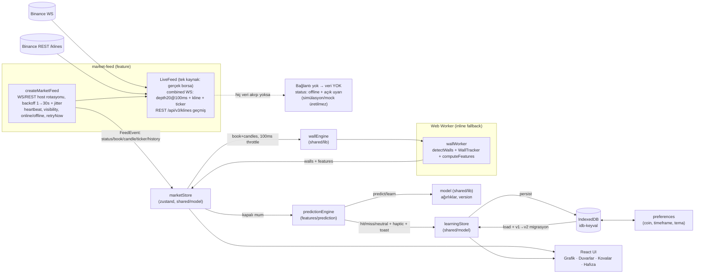

# LANKA v2 — Mimari

## Katmanlar ve Import Kuralları

```
app/        → her şeye erişebilir (orkestrasyon)
features/*  → entities/* + shared/*  (feature ↔ feature YASAK — eslint-plugin-boundaries)
entities/*  → tipler (shared'a erişebilir)
shared/*    → en alt katman (feature/app'a erişemez)
```

Cross-feature runtime state `shared/model` içinde yaşar (zustand store'ları);
saf alan algoritmaları (duvar, feature, model, buckets) `shared/lib` içindedir ki
hem feature'lar hem worker hem worker'ın inline fallback'i aynı kodu kullansın.

## Veri Akışı



## Kritik Akışlar

### 1. Canlı veri döngüsü

1. `app/useFeed` → `createMarketFeed({symbol, timeframe})` → `LiveFeed` (yalnız gerçek borsa).
2. WS birleşik stream'den mesaj → zod doğrulama → `FeedEvent` → `marketStore.apply`.
   Geçersiz/bozuk mesaj akışı düşürmez; eski `depth20` snapshot'ı (geriye düşen `u`) atılır.
3. Store 100 ms throttle ile `wallEngine.push({book, candles, config})` çağrır →
   worker `detectWalls` + `WallTracker.tick` + `computeFeatures` → sonucu store'a
   (`walls`, `features`) yazar. Main thread yalnızca render eder.
4. Kline kapanış (`k.x === true`) → `predictionEngine.handleClosedCandle`.
   Gerçek akışta mumlar (REST) ve kitap (WS derinlik) farklı zamanlarda hazır olur:
   ön koşullar (≥25 mum + kitap) sağlanmıyorsa kapalı mum **bekleyen mum** olarak
   tutulur ve veri geldiğinde yeniden denenir (deneme üst sınırı 3). Motor `false`
   dönerse çağıran taraf mumu işaretlemez.

### 2. Tahmin / öğrenme döngüsü

1. Kapalı mum C geldi → önceki `pending` tahmin var mı?
   - `move = (C.close − basePrice) / basePrice`, `threshold = atrMoveFactor · ATR(14)`.
   - `|move| < 0.25·threshold` → neutral; değilse yön eşleşirse hit, yoksa miss.
   - `learn`: `target = sign(move)·min(1, |move|/threshold)`; ağırlıklar güncellenir.
   - istatistik + kova (band) + `recent[]` (≤30) güncellenir → IndexedDB persist.
   - Öğrenme state'i diskten yüklenirken gelen taze doğrulamalar diskteki eski kayıtla
     ezilmez (`learningStore.revision`), ve motor ancak `loaded` olduktan sonra kurulur.
   - toast + `navigator.vibrate(50)`.
2. Yeni tahmin: worker'ın son `features` (yoksa inline `computeFeatures`) →
   `predictWith(weights, features)` → `pending` olarak persist edilir
   (sayfa yenilense bile bir sonraki mumda çözülür).

### 3. Sıralama / çökme koruması (mum penceresi)

Gerçek feed'de mumlar tek yönlü akmaz: yeniden bağlanma sonrası REST geçmişi canlı mumların
arkasından gelir, WS paketleri tekrar/gecikmeli düşebilir. Bu yüzden:

1. `shared/lib/candles.ts` listeyi her zaman **artan + tekil** tutar (`upsertCandle`,
   `mergeHistory`). Geçmiş geldiğinde liste değiştirilmez, canlı mumlarla **birleştirilir**.
2. Pencere yapısı değiştiğinde (`candlesRewriteSeq` artar) grafik artımlı güncelleme yapmaz.
3. `features/chart/lib/chartSync.ts` her veri değişiminde `skip | full | clear | tail`
   planından birini seçer. `tail` (artımlı `series.update`) yalnızca zaman **ileriye**
   gidiyorsa seçilir — böylece lightweight-charts'ın
   `Cannot update oldest data, last time=[object Object], new time=[object Object]`
   hatası oluşamaz (mesajdaki `[object Object]`, kütüphanenin iç zaman tipinin
   `{ _internal_timestamp }` nesnesi olmasındandır).

### 4. Bağlantı yok / hata senaryosu

- `navigator.onLine === false` → status `offline`; tarayıcı `online` olayında `retryNow()`.
- WS bağlanamaz / 30 sn mesaj yok (watchdog) → backoff (1→30 s + jitter) ile yeniden denenir;
  üst üste `OFFLINE_AFTER_ATTEMPTS` başarısızlıktan sonra status `offline` olur ve **denemeler
  sürer** (vazgeçilmez).
- Host rotasyonu: birincil host'a erişilemezse gerçek yedek host'lar denenir (WS ve REST).
- Geçmiş mum alınamazsa `HISTORY_RETRY_MS` aralığıyla yeniden denenir.
- **Hiçbir durumda uydurma veri üretilmez**: mum/fiyat/kitap yoksa arayüz bunu söyler
  (`StatusPill` + `ConnectionNotice` + grafik boş durumu ve "Yeniden bağlan" butonu).
- PWA: uygulama kabuğu SW önbelleğinden açılır; borsa yanıtları **NetworkOnly** ile
  çekilir (eski veriyi canlı gibi göstermemek için önbelleğe alınmaz).

## State Şeması (özet)

```ts
// marketStore (shared/model)
{ status, feedError, symbol, timeframe, price, ticker, book,
  candles[≤500, artan+tekil], candlesRewriteSeq, walls, features, lastEventAt }

// learningStore (shared/model) — sembol başına
{ weights: { version, values: {momentum, imbalance, wallPressure, trend, volatility} },
  stats: { total, hits, misses, neutrals, streak, bestStreak, lastUpdatedAt },
  recent: RecentValidation[≤30],
  buckets: { low, medium, high }: { band, total, hits, streak },
  pending: PendingPrediction | null }
```

## Thread Modeli

| Thread | İşler                                                                                    |
| ------ | ---------------------------------------------------------------------------------------- |
| Main   | React render, feed event dağıtımı (100ms throttle), store güncelleme, PWA                |
| Worker | `detectWalls` (20 satır), `WallTracker`, `computeFeatures` (≤500 mum), sonuç postMessage |

Worker'ın üretilemediği ortamlarda (test, bazı webview'lar) `wallEngine` aynı
`shared/lib` fonksiyonlarını main thread'de çalıştırır — davranış farkı yoktur.
